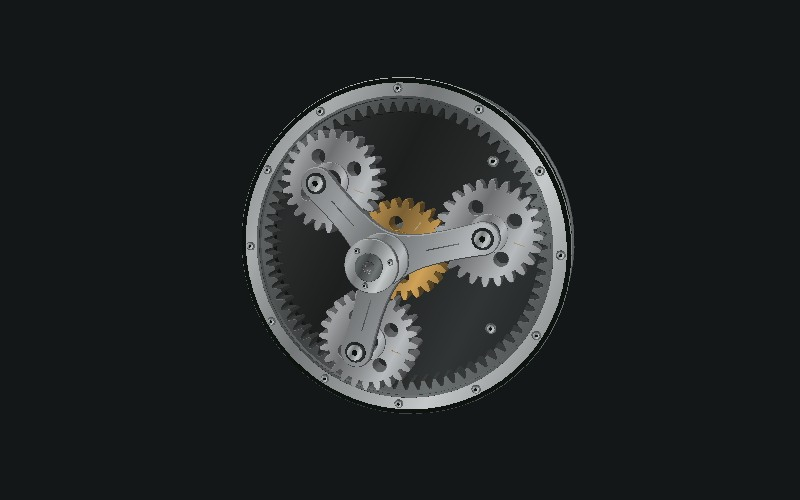

# Explain3D by funAgent

让 AI 把一个原理，做成可以亲手探索的 3D 作品。

[体验网站](https://explain.funagent.app) · [模板](https://explain.funagent.app/templates/) · [提示词](https://explain.funagent.app/create/) · [安装 Skill](https://explain.funagent.app/start/)



Explain3D combines a reusable Agent Skill, a synchronized scene runtime and ten runnable teaching templates. It helps create explanations, not only animations: each scene includes parameters, a question, a model boundary and a prompt.

## Run

Requires Node.js >=22.12. No npm dependencies or external CDN are needed.

```bash
npm test
npm run build
python3 -m http.server 8000 --directory dist
```

The parent funAgent website uses Astro. This independent showcase is statically generated with a small Node builder to keep the templates portable across Agent hosts. Scenes use vendored Three.js 0.170.0. Only the visible scene animates; covers are static renders of actual scene geometry.

## Templates

| Scene | What it explains | Adjustable input |
| --- | --- | --- |
| Planetary reducer | Fixed-ring 4:1 speed relationship | Input rpm |
| Slider-crank | Rotation to reciprocation | Rod length |
| Escapement | Alternating lock and release | Prescribed period |
| Smart ring | Concept component stack | Signal intensity |
| DC motor | Simplified current/commutation illustration | Direction |
| Thin lens | Ray intersection and image distance | Object distance |
| Eclipse | Alignment and orbit inclination | Inclination |
| Attention | Toy softmax of [2,1,0] | Temperature |
| Agent workflow | Scripted tool/check/retry events | Tool latency |
| Conveyor | Finite-buffer bottleneck/throughput | Middle service time |

## Install the Skill

Codex project:

```bash
mkdir -p .agents/skills
cp -R skills/create-spatial-explainer .agents/skills/
```

Claude Code project:

```bash
mkdir -p .claude/skills
cp -R skills/create-spatial-explainer .claude/skills/
```

Read [host adapters](adapters/README.md) for WorkBuddy, ChatGPT and DeepSeek. Installation documentation is distinct from independent host reproduction. Current templates were built in Codex; other hosts remain unverified.

Invoke `$create-spatial-explainer` and describe one principle. The Skill includes a local starter copier, scene contract, quality gates and publishing instructions. A new subject needs new geometry and constraints; changing labels is not a valid adaptation.

## Structure

- `apps/site`: site styles, browser interactions and real scene covers.
- `packages/runtime`: absolute-time playback, renderer, presentation controls and planetary model.
- `packages/scenes`: independent geometry/model adapters.
- `templates`: shared metadata and the full original planetary demo.
- `skills/create-spatial-explainer`: portable Skill and self-contained starter assets.
- `prompts`: create, remix and audit prompts.
- `evals`: physical, numerical, lifecycle and discrete-event invariants.
- `marketing`: channel copy and capture storyboard.

## Automatic publishing

Vercel Git integration creates branch previews and deploys the production branch. `vercel.json` runs `npm run check` (invariants + static build), so a failed check fails that deployment. GitHub Actions independently runs the same checks on PRs/main. GitHub release notes are published manually; no repository-write release workflow is included. No model API key is required by this website.

See [release operations](docs/RELEASING.md) for target IDs, actual setup and rollback. A configured workflow is not proof that a particular release succeeded; inspect deployment results.

## Validation and limits

See [validation](docs/VALIDATION.md). Automated checks cover gear constraints, slider closure, lens identity, softmax, event accounting, sampled finite geometry and backward seeking. Browser QA covers playback presentation and responsive layout in the available CPU fallback environment. Mobile GPU performance and device orientation require real-device checks. Do not infer engineering/manufacturing accuracy from the geometry.

Depth on ordinary screens comes from perspective, occlusion, materials and motion parallax. True binocular autostereoscopic output still requires suitable display hardware.

## Contribute

Read [CONTRIBUTING.md](CONTRIBUTING.md), open an issue, or send a template PR with a question, sampler, meaningful checks and explicit simplifications. Code is MIT. Keep third-party notices; see [THIRD_PARTY_NOTICES.md](THIRD_PARTY_NOTICES.md).
