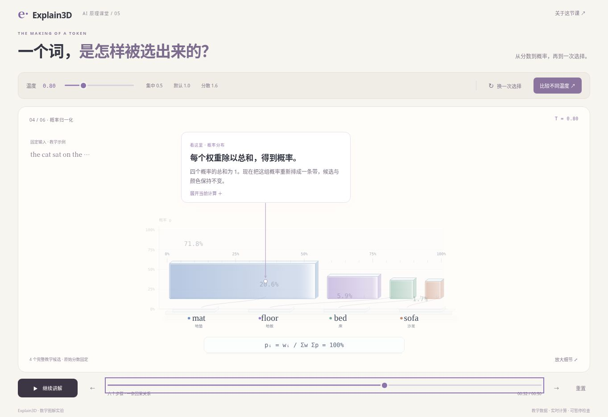
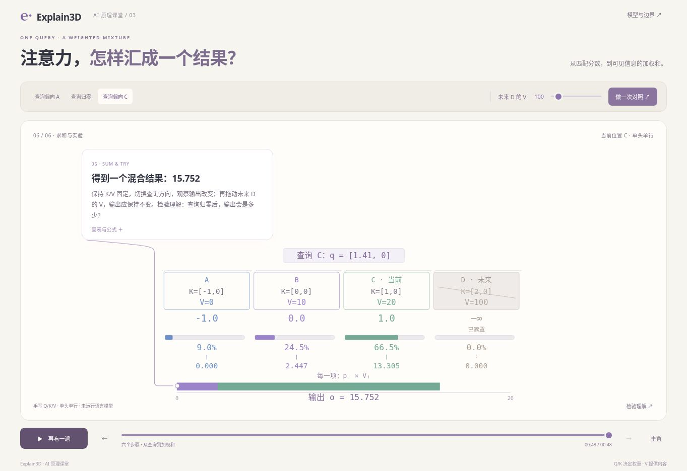
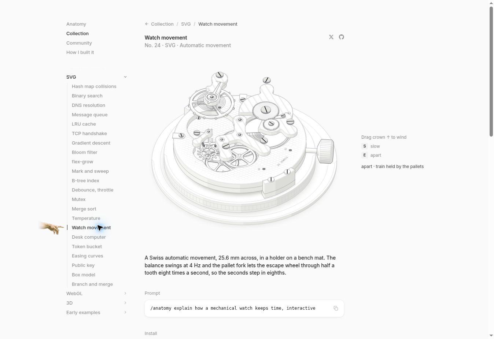

# 四个 AI 场景对照 Anatomy 的品质复审

日期：2026-10-28。结论：**四个场景已发布，但视觉与连续因果表达的验收重新打开，均需返工。** 已有数学检查和发布记录仍然有效；它们不能证明画面达到用户要求的细腻程度。本轮是审查，不是视觉改版发布，也不是学习者研究。

## 检查范围与证据

- Explain3D 最新 main：`71506a3df25484b67fae3f3725919f572026c693`。本地源文件树与远端一致；没有 AGENTS.md，开始检查时没有开放 PR/Issue。
- 实际浏览器查看四个生产页面的初始/代表性中间/结束画面，检查播放收起及 seek；在相同源代码构建的 390×844 iframe 中查看四个页面。桌面视口 1363×936。iframe 不是实体手机证据。
- 实际查看 Anatomy 在线 [Temperature](https://skills.wheresryan.sh/anatomy/collection/sampling) 和 [Watch movement](https://skills.wheresryan.sh/anatomy/collection/watch)，操作手表的 E 拆解，观察部件和读数一起变化。
- 阅读 Anatomy `SKILL.md`、craft/motion/verify 相关规则和 dial-indicator 构建实现。参考仓库 main：`1482e8469b0a9e0d8cc18ea2740a01423d29ae80`。在线作品与仓库示例不是同一个发布包，未声称二者逐字一致。
- 以下截图是实际浏览器原图，不是生成图、概念稿或后期补画。Anatomy 截图只作对照，作品归原作者 Ryan；[参考源码与 MIT 许可证](https://github.com/wheresryan22/anatomy)。没有复制其作品进入产品。
- 本轮没有重跑完整设备/无障碍/全部运动帧矩阵，也未执行 Anatomy 自带的几何审计程序。已发现的缺陷足以判定本轮不通过；不得把这次复审写成全项通过。

## 需要优先解决的问题

### P1 — Token 选择：变形中数字与对象脱离

[生产页面](https://explain.funagent.app/learn/token-choice/)：默认 T=0.8，将进度拖到 32 秒。柱图正在转成概率带，`20.6%` 会落在蓝色 mat 图形内部，而它属于紫色 floor。暂停时仍然存在，因此不是截图时序假象。

根因在 `apps/site/learn/token-choice/stage.mjs` 的 `render`：柱体的 x/y/宽/高使用 morph 插值，`b.number` 仍用原来的 `xs[i] + barW/2` 与 `base - h - 18`，只降低透明度。图形移动了，数字没有随所有者移动。概率标注的锚点还在 morph=.5 切换分支，需一并检查中途焦点的连续性。

修复要求：值和候选身份绑定到同一变形对象，或在专门保留的对应标注槽中持续清楚连接；不得只以快速淡出掩盖错误归属。回放、反向 seek、暂停在中间时都成立。

### P1 — Attention：计算链主要被写出来，没有被演出来

[生产页面](https://explain.funagent.app/learn/attention/)：输入、匹配分数、遮罩与 Softmax 阶段主要表现为文字、数字、细条的出现，学习者必须阅读气泡才能补全因果。

源码证据：`apps/site/learn/attention/stage.mjs` 只有 phase=4 的贡献条使用 progress 形成连续变化；其余阶段由 phase 切换重建图形。Q·K 的两个分量怎样得到匹配分数、共同分母怎样归一化、每份 V 怎样参与结果，都未形成可追踪的对象变化。正确的最终数值不足以解释计算过程。

还存在视觉层次问题：四个近似卡片承载全部 Q/K/V，身份颜色没有进一步形成“现在看哪一步”的层次；气泡及其长引线比主体更突出；最后的贡献条靠近舞台底部，主体上方空白很大。

### P1 — Token 分词：边界变化是跳切，查表缺少过程

[生产页面](https://explain.funagent.app/learn/tokenization/)：文字条与分段表达方向合适，但主要是几个带顶边的矩形。合并前后状态出现了，边界如何消失、哪些片段合到一起没有连续动作；ID 直接出现在下面，词表对应行只在弹窗中。

源码证据：`stage.mjs` 的缓存键只有 phase/step/word/limit/宽度，绘制没有使用 progress；阶段或合并步更新时 `replaceChildren()` 后直接画新矩形。需要保留字符位置及片段身份，展示匹配两片段、边界收拢、合并落定、映射词表行、编号回流的连续过程。规则未匹配时必须明确“跳过”，不能为了动画制造合并。

### P1 — Embedding：查表与坐标图之间丢失同一对象

[生产页面](https://explain.funagent.app/learn/embedding/)：已有整行复制及坐标作图，比 Attention 更有动作基础。但 `stage.mjs` 在 phase<3 与其余阶段走完全不同的布局，表格直接消失，向量坐标图出现，缺少同一向量从一行数值到两个坐标分量的交接。距离和余弦以小文字列出，测量与图形变化的联系仍弱。

修复要求：保留同一行向量的身份和颜色，逐个分量落到同尺度坐标轴，再形成向量；距离以端点间测量呈现，余弦通过方向夹角解释，避免把两者混成一个“相似”读数。定量坐标保持正投影和等比例，不能为立体感扭曲距离。

### P1 — 共用布局、字级与验收方法偏低

四页的布局壳比较整齐，但主体经常只是舞台下半部的一小块，较长的气泡占据第一视觉焦点。390px 下部分 K、遮罩、刻度文字缩到约 9–11px 量级，浅色细线进一步削弱识别；“没有溢出”不能等于“看得清”。

现有检查更重视数值、播放生命周期和路由发布，对“中途能否读懂”“放大能看到什么细节”缺少可复核的硬证据。不能再用整体截图、模型自评或测试通过替代这些证据。

### P2 — 公开 Skill 与工作版本的规范没有对齐

公开 `skills/create-spatial-explainer/SKILL.md` 仍从固定模板初始化；本次读取的工作版本已要求从自定义场景、部件关系和 exhibit-craft 开始。公开安装包没有完整承载这套规范。网站场景也没有落实精细建模、局部观察与连续变化的完整要求。

本轮未覆盖或提交工作目录里原有的 Skill 改动。后续应在一个场景通过新标准后，把经验证的方法回收到同一个通用 Skill，按 skill-creator 流程持久化和核对分发版本。不可把文档变多当成效果已改善，或声称未经实测的宿主兼容。

## Anatomy 细腻在哪里，以及该怎样借鉴

| 观察项 | Anatomy 的实现 | 当前场景的差距 | AI 场景应采用的方法 |
| --- | --- | --- | --- |
| 结构 | 对象、组件、功能零件和连接方式相互支撑 | 多为矩形、文字、条形图，加一小片顶边 | 为矩阵、向量、分词边界、遮罩、累计区间建立完整且可操作的结构 |
| 体积 | 实心填充、朝向明暗、接触阴影、遮挡和倒角一致 | 局部假厚度，没有连贯空间关系 | 给承载层轻厚度和接触关系；定量层保持正确刻度和投影 |
| 细节 | 细节服务真实连接与运行，放大后仍有结构 | 放大主要得到更大的字和框 | 可辨认的分量、行列索引、边界、刻度、计算入口与出口，不堆装饰螺丝 |
| 运动 | 一个输入改变部件，部件再引起下一响应 | 很多阶段只有数字显隐和文案切换 | 同一数学对象经过可追踪的变换，并在关键结果处停留 |
| 焦点 | 主体突出，活跃部件有明确强调 | 气泡很强，多个对象近似同权重 | 保留用户要求的一个气泡与箭头，缩短讲解，贴着当前对象出现 |
| 验收 | 源码规定近景、运动中间帧、深度和线端审查 | 多数证据只证明可运行和不遮挡 | 对照原图，检查 1×、4×、中间帧、390px，保留失败再修复的记录 |

参考细节：[SKILL.md](https://github.com/wheresryan22/anatomy/blob/1482e8469b0a9e0d8cc18ea2740a01423d29ae80/SKILL.md)、[craft](https://github.com/wheresryan22/anatomy/blob/1482e8469b0a9e0d8cc18ea2740a01423d29ae80/references/craft.md)、[motion](https://github.com/wheresryan22/anatomy/blob/1482e8469b0a9e0d8cc18ea2740a01423d29ae80/references/motion.md)、[verify](https://github.com/wheresryan22/anatomy/blob/1482e8469b0a9e0d8cc18ea2740a01423d29ae80/references/verify.md)。

Anatomy 的机械对象、无气泡和单色规则不能原样覆盖本项目。用户要的是彩色、带局部讲解的 AI 原理教学。借鉴工艺与自检方法；数学对象仍是主角，不把 Attention 包装成虚构的机械内部，也不把零件数量当品质分数。

## 返工顺序与通过条件

1. **Token 选择**：先修复 32 秒数字归属，保留已认可的柱图→概率带表达，补足连续转换和视觉层次，作为第一次基准复审。
2. **Attention**：重建 Q/K 匹配、遮罩、共同归一化、V 缩放与贡献汇合的连续过程。不是给四张卡片加阴影。
3. **Token 分词**：边界合并、词表查找及解码形成同一条连续操作链。
4. **Embedding**：把取行、分量、坐标及测量串为同一对象的演示。

每轮仍聚焦一个场景，不通过就继续修该场景。四个场景的新视觉检查关闭后，再按原依赖顺序进入 Transformer；既有生产链接和历史发布记录保留。

通过需要同时具备：

- 一眼可识别的主对象，以及输入、变化和输出；隐藏讲解正文时仍可从动作观察关键关系。此项是设计检查，不能冒充真实学习实验。
- 结构/承载、运算对象、当前焦点三个层次；1×整体和4×关键区域截图有真实细节，连接端点、边缘、遮挡正确。
- 关键变换的起点、中间多帧、终点与反向 seek 记录；每帧中数字、颜色、单位与对象归属一致。动画不能用错误中间状态换取“顺滑”。
- 390px 宽度下当前操作的标签/关键数值以可直接阅读的字级呈现，目标不低于14 CSS px；空间不够时做分步构图，不继续缩小整个 SVG。
- 保留一个短气泡和精确锚点；完整公式可展开，用户不必同时读多区文字。参数修改立即得到可解释的图形结果。
- 保留原数学与生命周期测试，再运行受影响的浏览器流程；变换新增的几何映射需要独立核对。
- 更新 LESSON 与复审记录，列出修复证据和仍未验证项。没有真实学习者研究就不宣称学习效果已实证。

本轮仅将上述结论和顺序写入项目与后续任务；网站实现和 Skill 分发内容尚未改变。
