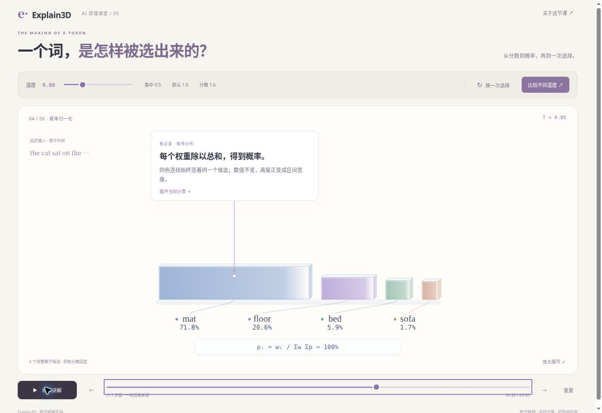
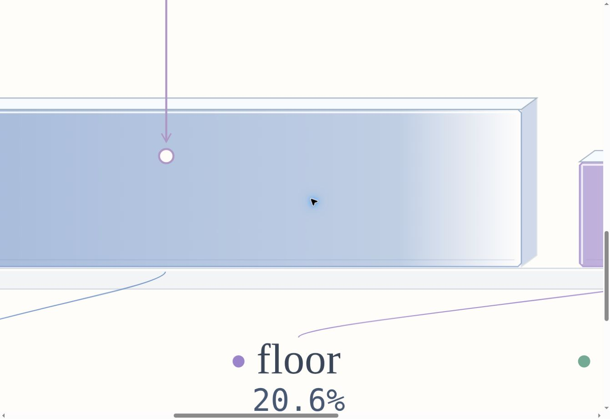
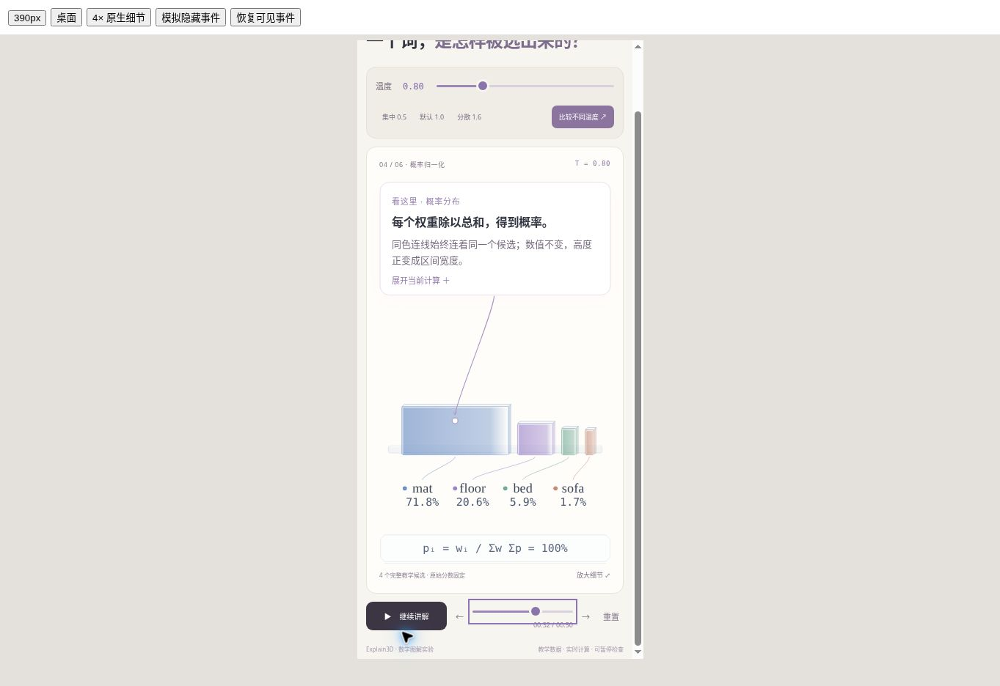
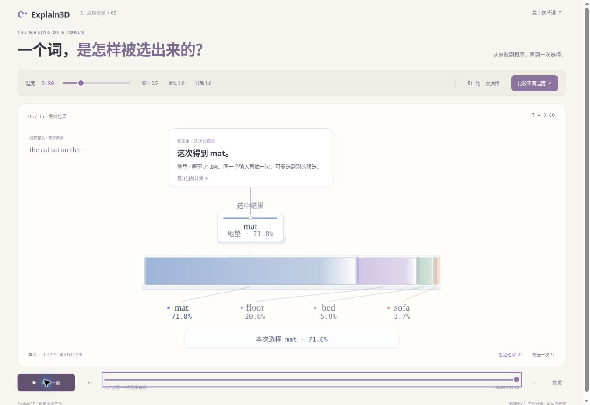

# Token choice rework candidate — 2026-10-28

Status: **implementation draft; NOT visually accepted, merged or published**. Base production/main: `0a3781278936c57f63de88dd9ab207fd1605dd2f`. All four published scenes retain `needs-rework`. This candidate is one step in token-choice rework, not a claim of Anatomy-level completion.

## Implemented changes

- Probability values no longer remain above the old bar positions while the rectangles move. From the probability chapter onward, candidate name and probability share one ordered identity lane. A color-matched line starts at that candidate's current front-face center/bottom and ends just above its identity. This remains meaningful for very narrow intervals.
- A pure geometry sampler owns the probability front faces, numeric-label positions, connectors and focus. The callout anchor follows a continuous point inside the moving blue face; it no longer switches between two anchor formulas at morph=.5.
- The interval band gains a shallow supporting edge; its actual widths remain probability-proportional. Extrusion shrinks with narrow interval width so depth does not overwhelm a tiny probability. These are drafted refinements, not browser-observed craft evidence.
- Narrow layout is recomposed to a 390-unit view rather than compressing 560 units; active value type remains 18 units and supporting type 16. Extra vertical drawing space is reserved. Initial settings may require vertical scrolling: the real 390px fit, active type size, viewport-height behavior and playing layout still require browser measurement. Do not infer legibility merely from declared font size.
- Narration now names the same-color correspondence and the height-to-width encoding. The interpretation is a change of representation, not probability changing during the morph.

## Checks actually run

`npm run check` passed, including existing independent mathematical golden values, all four AI scene tests, 721 planetary constraints and the site build. Added geometry invariants examine 3,620 poses: desktop/narrow, T=.4/.8/1/1.6/2, normal/reduced motion, 181 times between27s and36s per combination. They check disjoint front faces, values below every face, connector ownership, focus containment/continuity, exact final CDF positions and widths, and deterministic reverse seeking. Explicit default32s regression included.

These are numerical/geometric checks, **not browser screenshots, user study results or actual device evidence**. They do not certify font metrics, painted stacking, connector collisions, reduced-motion preference handling or UI lifecycle.

## Why the candidate remains a draft

The Browser plugin was discovered and its prescribed bootstrap attempted. It returned `Unknown tool(browser.js)`. No CUA browser surface was exposed in this run. The managed preview instructions prohibit improvising a shell browser. No preview server, screenshot or browser acceptance is claimed. This is an environment verification limitation, not a permission request.

Pending before merge:

1. Actually inspect defaultT=.8 at27,29,30,31,32,33,34,36s and the reverse sequence; repeatT=.4 and2, including smallsofa intervals. Inspect line routing, neighboring labels and pale-edge contrast.
2. Capture actual1× whole stage and meaningful4× detail with no substitute generated imagery. Check the added carrier, bevels, contacts, occlusion and ownership during movement.
3. Check390px viewport: read every active number and formula, measure effective CSS font size, verify no clipped axis maximum and inspect the scrolling tradeoff. Review desktop diagram size as well.
4. Exercise play/pause/resume/seek/replay/completion, temperature changes, keyboard, reduced-motion and hidden-tab behavior. Preserve the fixedu counterfactual T=.8→mat / T=2→floor and prediction check.
5. Continue causal refinements where needed: earlier temperature/exponent/normalization transitions are still phase-based. This candidate does not close the entire continuous-causality review.
6. Check protected branch preview; only after all applicable review gates pass, merge and verify matching production SHA/READY/domain.

No Skill distribution changed. Proven methods may be propagated after real visual verification through skill-creator, without overwriting unrelated personal Skill changes. No additional theme has started.

## Follow-up implementation and real browser review — 2026-10-28

The cloud browser became available in the subsequent user-authorized session. The earlier draft-only record above is historical. This follow-up implemented and inspected the candidate; production receipt is recorded separately after deployment.

### Changes beyond the draft

- The temperature/exponent/normalization chapters now carry an exact operand → operator → result rail. A deterministic pointer travels along that operation and its connection to the corresponding candidate, in mat/floor/bed/sofa order. No interpolated/fictitious mathematical values are introduced. The diagram explicitly describes this as a teaching pointer, not hardware compute latency; chapter boundaries still switch units discretely.
- Retained aligned front-face quantitative lengths, shallow side faces, bevel edges, base contacts and identity colors. Removed old chart scales early in the morph and introduced cumulative ticks only when the band is almost settled. On the result pose the ruler is intentionally withdrawn to leave room for the lifted result card; candidate probabilities remain visible below.
- Actual4× inspection revealed that the added carrier crossed the translucent fronts during the morph. Fixed it to follow the shared bottom surface, and added a non-intersection/contact invariant. A low-temperature390px playback exposed clipped left tick text; moved the axis into its reserved margin and rechecked large values.
- Raised active type, used a390-unit narrow composition and reserved drawing height. Added a manual reduced-motion setting in the lesson explanation alongside the existing OS preference support. Initial narrow settings can require vertical scrolling; playing removes them and keeps the exhibit/pause/timeline in one screen.

### Browser evidence actually observed

Environment: current Chrome cloud browser, desktop screenshot1363×936, same-source390×844 iframe (not physical phone), plus1200px iframe rendered at native CSS zoom4× (not an upscaled raster). Read-only DOM geometry showed key18-unit numbers at about14.89 CSS px in the paused narrow exponent layout (SVG scale .82747),22-unit candidate names at18.20px. Playing uses the available larger drawing area. Source-distribution/physical phone/OS preference coverage is not inferred from these observations.

| Check | Observed result |
|---|---|
| Forward morph | Actual paused27,29,30,31,32,33,34,36s frames inspected. Ordered values and color connectors retain their candidate ownership. No floor20.6% inside mat. |
| Reverse morph |36→32→29 inspected; corresponding geometry/labels returned to the same states. |
| Computation |8/12/20s rails show3÷.8=3.75,2÷.8=2.5,exp(3.75)=42.52, and normalization by59.19. Moving pointer remains on the drawn path. |
| Extremes |T=.4 band and tinysofa interval inspected, plusT=.4 exponent values up to1808 on narrow screen. FinalT=2 distribution and floor27.6% checked via prediction experiment. |
| Depth/detail |4× screenshot below shows front, top/side shading, bevel, carrier contact and identity connectors after the carrier repair. It is an inspectable mathematical exhibit, not a claim to match the part complexity of a physical watch. |
| Playback |Play/pause/resume exercised; progress moved with wall time and settings disappeared/reappeared. From49.5s natural completion reached50 and restored settings/quiz. Replay restarted near0; Escape paused. Home/End range keys and chapter stepping exercised. |
| Hidden |Controlled harness visibilitychange stopped playback at36.5s, restored settings and remained paused after visible event. This is an event-path test, not an OS tab-suspension or mobile backgrounding claim. |
| Reduced motion |Manual setting checked via actual dialog; subsequent seeking/chapter navigation used the reduced-motion branch. OS-level preference toggling not performed in this run. |
| Learning check |Narrow modal: wrongmat and correctfloor feedback inspected. Return-to-diagram preservedT=2,u=.6219,floor27.6%; explainsCDF boundaries .4551/.7311. |
| Model/site |npm run check passed: independent original golden values,3,620 geometry poses, exact operation equations, rail-anchor continuity, carrier contact, existing four-scene tests and721 planetary constraints. |

### Teaching review decision

This is developer teaching/visual review, not measured learning-effect research or user aesthetic approval. The bounded question remains how fixed scores and one fixed uniform sample produce one chosen candidate. The first view names the input/scores and makes score≠probability explicit; the operation rail links exact values to colors; the morph changes representation without changing probability; a fixed-u temperature experiment changes the selected result and explains why. Those observations close the listed token-choice ownership, narrow-readability, continuity and contact defects for this revision. The same benchmark is still open for Attention, tokenization and embedding; no new topic is authorized to bypass that queue.

Limits: no real learner sessions, physical phones, screen readers, other browser engines, OS preference switching or hardware performance measurements. No award/equivalent-fidelity claim. Public/working Skill alignment remains a distinct pending task; this release does not claim a new installed or cross-host-verified Skill.

## Production follow-up receipt — 2026-10-28

PR #6 reviewed head `e6b74581f6a126e1d0fca9e3b72fa615407c35c2`: branch CI40676595210 success; READY preview `dpl_GqK2VrNBQNNF4WFbzUy1pKd3hJvm`. Authenticated preview HTML/app/model/stage/geometry/style responses returned200 and matched the reviewed source exactly. Preview HTTP evidence is distinct from same-source local browser actions.

Merged source `26defa3024d64af69f8a4da8f66e8d23287cb523` reached production READY as `dpl_2BqeL1ySywcQwDayqUr8CqyPzoeW`; main CI40676875334 succeeded. Actual public route https://explain.funagent.app/learn/token-choice/ loaded without sign-in. Production browser inspected default32s label ownership and completed the prediction check: correctfloor feedback and return-to-diagramT=2,u=.6219,floor27.6%. The stable result withdraws the ruler, avoiding result-card/tick occlusion. Course remains4/10; next quality rework isAttention, with new topics held until the other three are reviewed. Original publication receipts remain intact.
